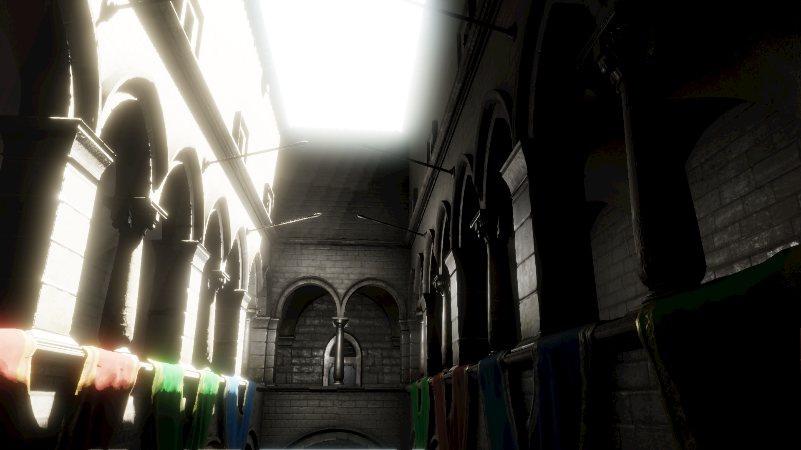
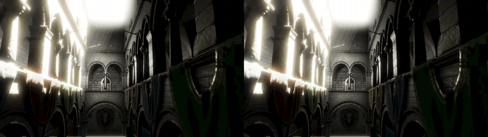
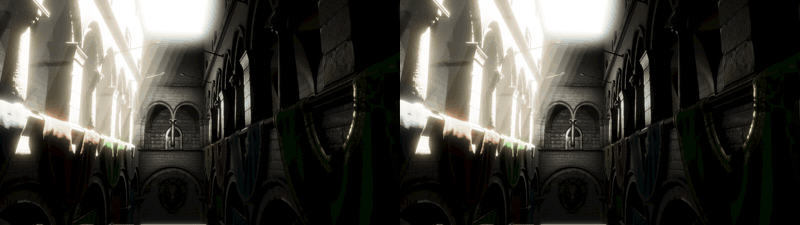
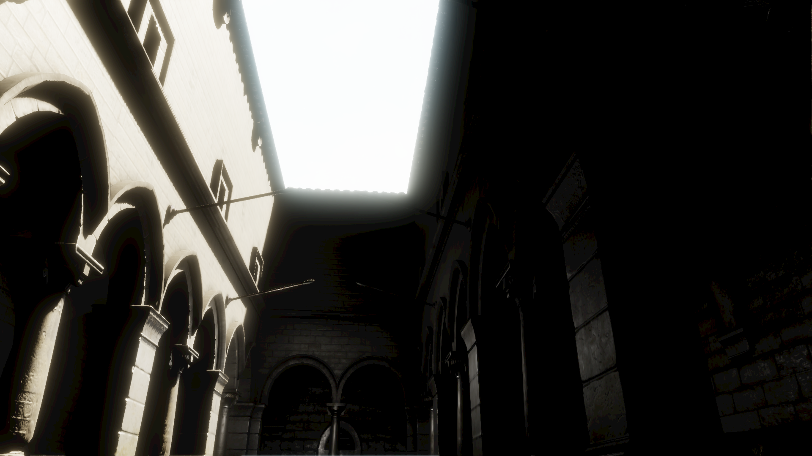
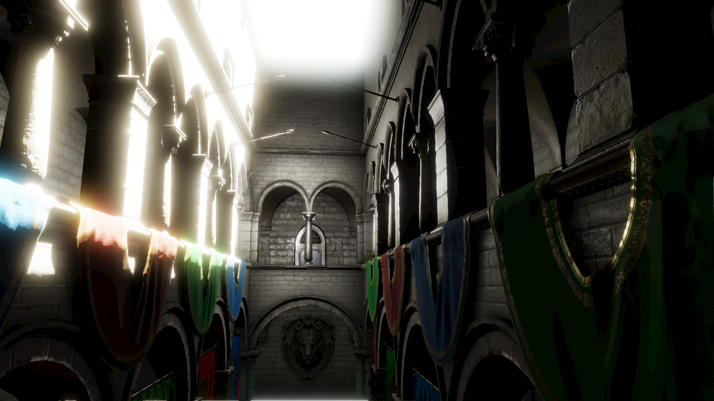
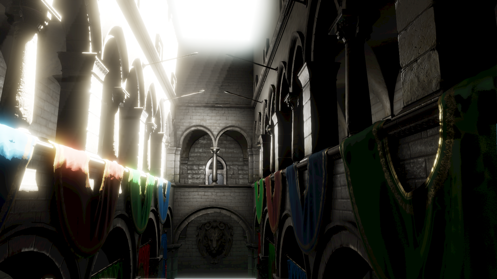
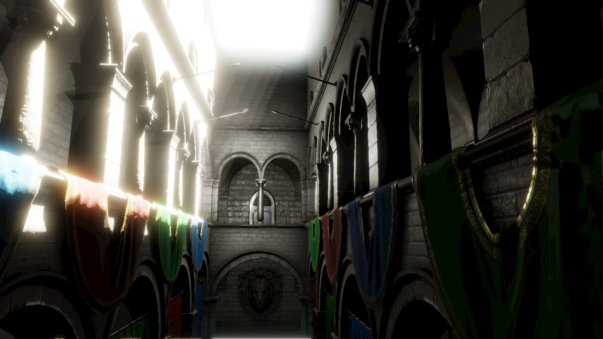

# 基于 MoerEngine 渲染研究引擎的体积雾设计、优化与论文适配

## 摘要

本次实践研究从MoerEngine渲染引擎出发，先基本学习了MoerEngine的渲染原理，了解到MoerEngine的引擎优势，从零搭建 Froxel 体积雾、逐步引入时域稳定化与深度保边合成、注入动态 Probe GI 间接光、适配 FAST (Filter-Adapted Spatio-Temporal) 采样论文、并最终构建世界空间自适应稀疏体积辐射缓存 (Volumetric Radiance Cache, VRC) 的完整实践过程。实现了适配于MoerEngine的体积雾渲染，并在一定程度上与UE的效果进行了模仿，也契合了MoerEngine的特点。文中给出了各阶段的效果图及性能数据，最终在 RTX 4060 Laptop GPU / Vulkan / 1920×1080 / Sponza 场景下进行了性能测评。

## 1. 研究思路

MoerEngine 是一个以现代 GPU 技术为基础、强调渲染算法透明度与跨层可修改性的开源研究引擎。通过配置结构体、UI 控件、共享参数头、Pass 类和 Shader 文件就可以实现目标渲染效果。本次研究基于MoerEngine，通过参考UE的体积雾渲染，以以下四步步骤进行实现：
1. 对齐 UE 的基础 Froxel + 时域重投影方案，建立可用的体积雾 MVP；并与UE的体积雾效果进行对比，实现MoerEngine可支持的优化。
2. 利用 MoerEngine 独有的动态 Ray Query Probe GI 基础设施，为体积雾注入可随场景更新的间接光；
3. 选择一篇与 Moer 架构相性匹配的近期采样论文（FAST）进行工程化适配；
4. 在自适应稀疏 Probe 层级上构建独立的介质辐射缓存（VRC），补全世界空间低频间接雾光。

## 2. MVP 搭建：Froxel 体积雾核心

### 2.1 总体数据流

体积雾采用与相机视锥对齐的 Froxel（Frustum + Voxel）三维网格。在 1920×1080 分辨率下，XY 方向每 12×12 像素一个 Froxel，Z 方向 64 个指数分布切片，构成 `160×90×64 = 921,600` 个体素。

每帧渲染管线如下：

```
InjectDensity → TemporalReprojection → IntegrateScattering → Composite
(密度/光照/CSM/ProbeGI注入)  (时域重投影+7-tap clamp)  (Beer-Lambert沿视线积分)  (深度感知上采样合成)
```

### 2.2 Froxel 网格与世界坐标重建

Froxel 的 Z 切片采用指数分布，在引擎 Reverse-Z 约定下重建世界坐标。对于 Froxel $(i, j, k)$，其代表点的世界位置通过以下步骤计算：

$$
\text{slice\_fraction} = \frac{k + 0.5}{N_z}
$$

$$
\text{view\_depth} = z_{\text{near}} \cdot \left(\frac{z_{\text{far}}}{z_{\text{near}}}\right)^{\text{slice\_fraction}}
$$

$$
\mathbf{p}_{\text{world}} = \mathbf{o}_{\text{camera}} + \hat{\mathbf{r}} \cdot \frac{\text{view\_depth}}{|\hat{\mathbf{r}}_z|}
$$

其中 $\hat{\mathbf{r}}$ 是从相机到该 Froxel 远平面交点的归一化方向向量。

### 2.3 介质模型

采用指数高度雾模型，密度随高度衰减：

$$
\sigma_{\text{ext}}(y) = \sigma_{\text{base}} \cdot \exp\left(-h_{\text{falloff}} \cdot (y - y_{\text{offset}})\right)
$$

其中 $\sigma_{\text{ext}}$ 是消光系数，$h_{\text{falloff}}$ 是高度衰减率，$y_{\text{offset}}$ 是参考高度。同时支持局部球形雾体，使用径向平滑过渡：

$$
\sigma_{\text{local}}(\mathbf{p}) = \sigma_{\text{local\_density}} \cdot \text{smoothstep}\left(1 - \frac{\|\mathbf{p} - \mathbf{c}_{\text{local}}\|}{r_{\text{local}}}\right)^{e_{\text{falloff}}}
$$

### 2.4 沿视线积分与合成

对每个像素，沿视线方向从近到远累积散射 $L$ 和透射率 $T$：

$$
L_{\text{accum}} \mathrel{+}= L_{\text{scat}} \cdot T_{\text{current}} \cdot \Delta s
$$

$$
T_{\text{current}} \mathrel{\cdot}= \exp(-\sigma_{\text{ext}} \cdot \Delta s)
$$

积分在像素场景深度处停止，避免雾穿过不透明几何体。合成阶段将低分辨率 Froxel 积分结果上采样到全分辨率，并使用深度引导权重防止跨深度断层的混合。

## 3. UE 对齐的优化与稳定性修复

### 3.1 时域重投影与稳定网格语义

时域重投影的核心思想是：将上一帧的历史 Froxel 数据重投影到当前帧网格，与当前帧结果混合，以低计算成本实现超采样。

#### 3.1.1 关键问题：Jitter 导致的闪烁

初始实现中，Halton 2/3/5 序列同时扰动 Froxel 的密度采样位置、光照查询位置和 CSM 阴影查询位置。这导致两个问题：

1. **历史纹理整体平移**：时域 Pass 把代表"固定 Froxel 单元时间平均"的历史纹理按相邻两帧 Halton 差值平移重采样，使静止场景也无法收敛。
2. **阴影边缘随机游走**：CSM 深度比较使用逐帧变化的 Jitter 世界坐标，PCF 核在高对比阴影边界反复跨边。

#### 3.1.2 解决方案：稳定网格语义

**历史纹理应代表稳定、未抖动 Froxel 单元上的时间平均**，不应随 Jitter 整体平移。因此引入双位置采样：

```hlsl
// InjectDensity.hlsl 中的稳定 vs 抖动二分法

// Jittered position: only for stochastic density sampling
const float3 froxel_jitter = sample_froxel_jitter(dispatch_thread_id);
const float2 jittered_uv =
    (float2(dispatch_thread_id.xy) + 0.5 + froxel_jitter.xy) / float2(width, height);

// Stable position: for CSM, lighting, and Probe GI queries
const float2 stable_uv =
    (float2(dispatch_thread_id.xy) + 0.5) / float2(width, height);
const float stable_slice_fraction =
    (float(dispatch_thread_id.z) + 0.5) / float(depth);
```

### 3.2 深度保边合成

合成阶段最初使用最近 Froxel 采样，随后改为 XY 双线性 + 指数 Z 线性插值的三线性采样。但 XY 双线性只考虑屏幕距离，未比较四个 Froxel 代表像素的场景深度，导致前景/背景深度断层处会把背景雾混入物体轮廓（"Halo"）。

#### 3.2.1 深度引导权重

引入几何深度权重：同深度层保持双线性，深度差异按相对距离指数衰减：

$$
w_{\text{depth}} = \exp\left(-\frac{|d_{\text{center}} - d_{\text{neighbor}}|}{\sigma_{\text{depth}}}\right), \quad
\sigma_{\text{depth}} = \max\left(0.25,\; \min(d_{\text{center}}, d_{\text{neighbor}}) \cdot 0.04\right)
$$

```hlsl
// CompositeVolumetricFog.hlsl 中的深度引导上采样

float geometry_depth_weight(
    float center_view_depth, uint2 volume_xy,
    uint2 volume_dimensions
) {
    const float neighbor_view_depth = scene_view_depth_at(
        froxel_center_pixel(volume_xy, volume_dimensions));
    const float depth_sigma = max(0.25, min(center_view_depth,
        neighbor_view_depth) * 0.04);
    return exp(-abs(neighbor_view_depth - center_view_depth) / depth_sigma);
}
```

当四个邻域均失配（极薄轮廓）时，回退到最近 Froxel，避免背景雾穿透。

### 图2：深度保边合成效果对比（frame 045）

| MVP 体积雾（轨迹中段，无深度保边） | 优化后体积雾（轨迹中段，深度保边合成） |
|:---:|:---:|
|  |  |

> **图2说明：** 深度保边合成效果对比（frame 045）。左图 MVP 版本缺少深度引导权重，前景/背景深度断层处出现雾穿透几何轮廓的现象；右图优化后版本通过深度引导双线性插值和极薄轮廓回退机制，有效保留了柱体和帘布边缘。

## 4. 动态 Probe GI 注入

### 4.1 动机
我们期望加入具有MoerEngine 特性的优化，以提升体积雾渲染效果，通过调研以后，我们决定引入动态 Probe GI 注入。

UE 的体积雾使用烘焙或实时捕获的环境光作为低频边界辐射。MoerEngine 拥有独特的动态稀疏 Ray Query Probe GI 系统，它不依赖烘焙，可以在场景变化时实时更新方向辐照度。如果能将这套 Probe GI 接入体积雾，就能实现可随场景动态变化的间接雾光。

### 4.2 工作组共享查询

逐 Froxel 查询 Probe GI 的开销不可接受。利用 Compute Shader 的工作组共享内存，实现每 `4×4×4` Froxel 工作组（64 个 Froxel）共享一次世界空间 Probe GI 查询：

```hlsl
// InjectDensity.hlsl 中的工作组共享 Probe GI 查询

const float3 group_world_position =
    stable_world_position_from_froxel(group_center, volume_size);

groupshared float4 group_probe_cache;
groupshared float4 group_probe_cache_meta;

// Only thread 0 in the group queries the radiance cache
if (all(dispatch_thread_id % 4 == 0)) {
    group_probe_cache = sample_group_probe_radiance(group_world_position, ...);
}
GroupMemoryBarrierWithGroupSync();

const float3 group_probe_radiance = group_probe_cache.rgb;
```

### 4.3 四面体方向轮换

Probe GI 使用球面四面体基进行方向重建。如果每个 Froxel 都查询同一方向，会导致方向偏差。解决方案是每帧将四面体方向旋转 90°，在四帧内覆盖完整方向球面。这不新增体积缓存或 Dispatch，只改变查询方向参数。

## 5. FAST 采样论文适配

### 5.1 论文选择过程

在完成基础体积雾和 Probe GI 注入后，我期望能找一篇与 MoerEngine 架构相性匹配的采样论文，以此实现渲染效果的优化；在AI的帮助下，我们从近3年有关体积雾的研究中，选择了 FAST Froxel Jitter。最近两年的论文多数与深度学习相关，由于时间限制，我们很难再短期时间内完成复现与模型的训练，因此我决定优先完成FAST的相关适配，而其他论文可以作为后期的研究方向。

| 候选方案 | 相性 | 研究价值 | 可实现性 | 结论 |
|---|:---:|:---:|:---:|---|
| FAST Froxel Jitter | 5 | 5 | 4 | **本轮实施** |
| STBN Froxel Jitter | 3 | 5 | 3 | 作为 A/B 基线 |
| 局部灯 ReSTIR | 3 | 4 | 4 | 后续研究 |
| 神经多次散射 | 2 | 5 | 2 | 需 TensorRT |

它具有如下优势：
1. 它直接处理"全屏统一 Halton 空间相关"的问题，与 Moer 的 Froxel Jitter 完全对应；
2. 它不增加新的 Render Pass、全分辨率纹理或 Ray Query；
3. 它不破坏已有的稳定网格语义、CSM 稳定性和 Probe GI 查询；


### 5.2 FAST 原理简述

FAST 的核心思想是：**采样器的误差不应只看单帧频谱，还应与实际的时间滤波器匹配**。传统 STBN（Spatio-Temporal Blue Noise）只优化蓝噪声频谱，但不知道引擎使用的是 0.94 历史权重、7-tap 非线性 Clamp 和动态历史拒绝。FAST 则根据这些滤波器参数生成更优的时空样本。

### 5.3 工程化适配

#### 5.3.1 FAST 噪声纹理

使用公开生成器生成的 `Vector3` FAST 纹理，参数为 `gauss1_exp006_beta010`：

- 尺寸：`64×64×32`（空间 XY + 时间 Z），RGBA8 格式
- 显存：`64×64×32×4 = 524,288` 字节 ≈ 0.5 MiB
- 选择 `Vector3` 而非三张独立标量纹理：让 XYZ 联合样本空间也参与优化
- 选择 RGBA8 而非浮点格式：Jitter 的量化误差远小于 Froxel 尺寸

#### 5.3.2 C++ 加载与回退

```cpp
// VolumetricFogPass.cpp 中的 FAST 纹理加载

static constexpr std::string_view fast_noise_filename =
    "volumetric_fog_fast_vector3_gauss1_exp006_beta010_64x64x32.rgba8";

// If FAST texture is unavailable, silently fall back to Halton
if (IsFastNoiseMode(active_jitter_mode) && !fast_noise_ready) {
    active_jitter_mode = EVolumetricFogJitterMode::HALTON;
    LOG_WARNING("[VolumetricFog][FAST] Noise unavailable; using Halton fallback.");
}
```

#### 5.3.3 Shader 采样

```hlsl
// InjectDensity.hlsl 中的 FAST 采样

uint noise_width, noise_height, noise_frames;
fast_noise_texture.GetDimensions(noise_width, noise_height, noise_frames);
const uint frame = param.jitter_frame_index % max(noise_frames, 1u);
const uint cycle = param.jitter_frame_index / max(noise_frames, 1u);

// FAST is optimized on a torus. Integer offsets preserve the stored
// sample values and the intra-frame spectrum, while extending a finite
// time cycle without re-hashing the samples.
uint2 offset = uint2(fog_hash(cycle ^ 0x9e3779b9u),
                      fog_hash(cycle ^ 0x243f6a88u));
if (param.jitter_mode == FAST_XYZ_OFFSET) {
    offset += uint2(froxel_id.z * 37u, froxel_id.z * 17u);
}
const uint2 coordinate = uint2(
    (froxel_id.x + offset.x) % max(noise_width, 1u),
    (froxel_id.y + offset.y) % max(noise_height, 1u)
);
return fast_noise_texture.Load(int4(coordinate, frame, 0)).rgb - 0.5;
```

关键设计：FAST 在环面（torus）上优化，通过整数偏移扩展有限时间周期，保持存储样本值和帧内频谱不变。

#### 5.3.4 两种 FAST 模式

- **FAST_XY**：仅在 XY 方向使用 FAST 纹理采样，Z 方向仍使用 Halton
- **FAST_XYZ_OFFSET**：在 XY 基础上，按 Z 层额外偏移，扩展空间去相关


### 图3：Halton 与 FAST XY 运动对比（默认密度）

在默认低密度配置（`base_density=0.006`）下，以下 GIF 展示了 Benchmark 轨迹中的运动行为：



> **图3说明：** Halton（左）与 FAST XY（右）在默认低密度场景下的运动并排对比。两者画面几乎无可见差异——120 帧 warmup 后时域滤波已充分收敛，低密度场景中采样位置偏移对密度值的影响微乎其微。

### 图4：高对比度场景运动对比

为放大采样器差异，使用 `highcontrast` preset（`base_density=0.020`，`height_falloff=0.35`，`phase_g=0.60`，局部雾体 `density=0.025`）：



> **图4说明：** Halton（左）与 FAST XY（右）在高对比度场景下的运动并排对比。高密度和陡梯度使采样位置偏移对密度值的影响增大，两种采样器的差异变得更加可量化。

### 像素差异量化

| 帧 | 默认密度 YAVG | 默认密度 YMAX | 高对比度 YAVG | 高对比度 YMAX | 差异倍数 |
|---:|---:|---:|---:|---:|---:|
| 0 | 0.008 | 2 | 0.160 | 8 | 20× |
| 10 | 0.008 | 1 | 0.147 | 6 | 18× |
| 30 | 0.008 | 1 | 0.140 | 7 | 18× |
| 45 | 0.022 | 4 | 0.092 | 4 | 4× |
| 75 | 0.011 | 2 | 0.049 | 4 | 4× |
| 89 | 0.004 | 1 | 0.053 | 4 | 14× |

*表：Halton 与 FAST XY 的帧级像素差异（YAVG = 平均亮度差/255，YMAX = 最大亮度差/255）*

### 图4b：未收敛场景运动对比（模拟相机切换）

上述对比均在 120 帧 warmup 后（时域已收敛）进行。但实际游戏中，相机切换、快速转头或进入新区域时，历史会失效，体积雾需要从零重建。为模拟这一场景，使用 `nocoverage` preset：

- **warmup 仅 10 帧**（而非 120 帧），捕获时域尚未收敛的前几帧
- **history_weight = 0.50**（而非 0.94），每帧采样贡献更大，收敛更慢
- **高密度 + 陡梯度**（与 highcontrast 相同的介质参数）


> **图4b说明：** Halton（左）与 FAST XY（右）在未收敛场景下的运动并排对比。低历史权重下时域滤波来不及平滑采样差异，两种采样器的空间分布差异直接暴露在画面上。

### 未收敛场景像素差异量化

| 帧 | 收敛场景 YAVG | 收敛场景 YMAX | 未收敛 YAVG | 未收敛 YMAX | 增大倍数 |
|---:|---:|---:|---:|---:|---:|
| 0 | 0.160 | 8 | 0.002 | 1 | — |
| 10 | 0.147 | 6 | 0.018 | 4 | 8× |
| 20 | — | — | 0.069 | 5 | — |
| 30 | 0.140 | 7 | 0.111 | 9 | — |
| 45 | 0.092 | 4 | 0.200 | **12** | 2× |
| 60 | — | — | 0.177 | 7 | — |
| 75 | 0.049 | 4 | **0.278** | 7 | **6×** |
| 89 | 0.053 | 4 | 0.100 | 7 | 2× |

*表：未收敛场景与收敛场景的 Halton vs FAST 像素差异对比*

## 6. 自适应稀疏体积辐射缓存 (VRC)

### 6.1 动机与定位

Froxel 体积雾的视锥网格只能覆盖相机附近的有限范围。对于远处的间接雾光，需要一个稳定的世界空间缓存。UE 使用烘焙的体积光照贴图（VLM），但 Moer 没有烘焙管线。针对MoerEngine的在线引擎特点，我们使用了VRC（VolumeRadianceCache）来存储世界空间缓存。

Moer 的动态稀疏 Probe GI 已经拥有完整的 Cell → Brick → Page Table → Streaming → Dirty Tracking 基础设施。VRC 的思路是**复用这套稀疏层级，存储独立的参与介质辐射数据**。

### 6.2 自适应稀疏布局与调度

VRC 复用 Probe GI 的 Volume → Cell → Brick → Page Table 结构，但加入了**介质感知**的细化调度：

1. 对每个 Probe Cell 采样中心与 8 个角点，估计全局指数高度雾和局部球形雾的平均密度
2. 计算相对密度梯度、屏幕贡献和介质优先级
3. 将介质期望层级与原有几何期望层级合并；高密度、高梯度或高屏幕贡献区域优先细化
4. 更新调度在 mandatory/dirty 优先级之后加入介质优先级和更新年龄，受每帧 Brick 预算约束

| 参数 | 默认值 | 作用 |
|---|---:|---|
| Density Threshold | 0.0010 | 判断 Cell 是否需要体积缓存 |
| Gradient Threshold | 0.18 | 密度变化较大时细化 |
| Screen Weight | 1.0 | 屏幕贡献权重 |
| Priority Weight | 2.0 | 更新调度中的介质优先级权重 |
| History Weight | 0.88 | 双缓冲历史融合 |
| Multi Scatter | 0.12 | 受控的近似高阶散射反馈 |
| Transmittance Steps | 6 | 介质光学深度积分步数 (2–12) |

*表：VRC 自适应调度参数*

### 6.3 独立 L1 方向辐射缓存

每个物理 Probe 保存 L0（各向同性）和 L1-X/Y/Z（一阶方向性）：

$$
L(\mathbf{d}) = L_0 + L_{1x} \cdot d_x + L_{1y} \cdot d_y + L_{1z} \cdot d_z
$$

- 最多 2048 个物理 Probe，单份缓存 163,840 字节
- 采用 history/write 双缓冲，更新前复制未调度记录，随后只覆盖本帧稀疏 Brick
- 双缓冲共 327,680 字节 ≈ **0.3125 MiB**，没有新增密集 3D 辐射纹理

### 6.4 介质感知传输

#### 6.4.1 直接光散射源

第一阶直接光先转换为介质散射源再缓存，避免在 Froxel 注入阶段重复计算一次散射：

$$
L_{\text{direct}} = \sum_{\text{lights}} \Phi_{\text{light}} \cdot V_{\text{RayQuery}} \cdot T_{\text{medium}} \cdot \sigma_{\text{scat}} \cdot p(\theta)
$$

其中 $V_{\text{RayQuery}}$ 是通过硬件 Ray Query 对不透明几何执行的可见性测试，$T_{\text{medium}}$ 是沿光线 2–12 步的 Beer-Lambert 透射率积分。

#### 6.4.2 历史邻域多次散射

从上一帧缓存采样 6 个邻居，按透射率衰减提供受控的近似多次散射反馈：

```hlsl
// UpdateRadianceCache.hlsl 中的邻域多次散射

const float transmittance = integrate_medium_transmittance(
    current_position,
    safe_normalize(neighbor.world_position.xyz - current_position, float3(0,1,0)),
    distance
);
radiance_sum += max(neighbor.l0.rgb, 0.0) * transmittance * saturate(neighbor.l0.w);
weight_sum += saturate(neighbor.l0.w);
```

### 图5：四种状态对比（轨迹终点 frame 89）

| 无体积雾（轨迹终点） | MVP 体积雾（轨迹终点） |
|:---:|:---:|
|  |  |

| 优化后体积雾（轨迹终点） | FAST 体积雾（轨迹终点） |
|:---:|:---:|
|  |  |
> **图5说明：** 四种状态在 Benchmark 轨迹终点（frame 89）的对比。优化后和 FAST 版本均开启 Probe GI + VRC，暗区获得彩色间接雾光。

---

## 7. 性能实测与效果展示

### 7.1 效果展示

### 图1：四种状态对比（轨迹起点 frame 0）

| 无体积雾（`off`） | MVP 体积雾（`mvp`：无时域、PCF0） |
|:---:|:---:|
|  |  |

| 优化后体积雾（`halton`：时域+深度保边+CSM PCF1） | FAST 体积雾（`fast_xy`：FAST XY 采样替换 Halton） |
|:---:|:---:|
|  |  |

### 7.2 测试环境

| 项目 | 值 |
|---|---|
| GPU | NVIDIA GeForce RTX 4060 Laptop GPU (8188 MiB) |
| CPU | Intel Core i7-13700H (14C/20T) |
| 内存 | 32 GiB |
| RHI | Vulkan, API 1.4.325 |
| 构建 | Debug, Clang 22.1.8 + Ninja |
| 分辨率 | 1920×1080 |
| 场景 | Sponza (`Camera.001`) |
| Froxel 网格 | 320×180×64 = 3,686,400 个体素 |
| 体积雾显存 | 自有资源 31.89 MiB + FAST 噪声 0.50 MiB = 32.39 MiB |

### 7.3 配置对比

以下数据通过引擎内置 GPU Timestamp Scope 每秒采样获得。Benchmark 以固定时间步长（1/60s）运行，120 帧 warmup 后进入 90 帧轨迹，丢弃前 3 条记录取稳定值。

**关闭 Probe GI 的历史对照（Froxel 160×90×64）：**

| 配置 | GraphicsExec (ms) | FogTotal (ms) | 说明 |
|---|---:|---:|---|
| Fog Off | 14.043 | 0.000 | 热态基线 |
| 完整功能 (Halton) | 14.639 | 0.561 | Probe GI 关闭 |
| 完整功能 (FAST XY) | 14.721 | 0.571 | Probe GI 关闭 |

**本次本机实测（Froxel 320×180×64，Probe GI + VRC 开启）：**

| 配置 | GraphicsExec 均值 (ms) | FogTotal 均值 (ms) | StdDev (ms) |
|---|---:|---:|---:|
| Fog Off (基线) | ~11.2 | — | — |
| 完整功能 (Halton + Probe GI + VRC) | 17.173 | 6.508 | 0.183 |

> Froxel 网格从 160×90×64 升级到 320×180×64（4× 体素），且 Probe GI 注入从关闭变为开启。FogTotal 增大主要来自 Probe GI 注入开销。

### 7.4 阶段分解

以下为本次实测的逐 Pass GPU 时间分解（6 个一秒采样均值）：

| 阶段 | 均值 (ms) | 标准差 (ms) | FogTotal 占比 |
|---|---:|---:|---:|
| CSM 阴影采样 | 0.143 | 0.004 | 2.2% |
| 阴影时域滤波 | 0.104 | 0.014 | 1.6% |
| **光照/CSM/ProbeGI 注入** | **5.760** | **0.193** | **88.5%** |
| 介质时域重投影 | 0.232 | 0.000 | 3.6% |
| Beer-Lambert 积分 | 0.049 | 0.001 | 0.8% |
| 调试可视化 | 0.015 | 0.000 | 0.2% |
| 深度感知合成 | 0.203 | 0.021 | 3.1% |
| VRC 稀疏更新 | 0.066 | 0.001 | 1.0% |
| **合计** | **6.508** | **0.183** | **100%** |

### 7.5 VRC 开销验证

VRC 稀疏更新在历史报告和本次实测中开销一致：

| 数据来源 | VRC 更新 (ms) | Froxel 网格 | Probe GI |
|---|---:|---|---|
| 历史报告 | 0.064 | 160×90×64 | 关闭 |
| 本次实测 | 0.066 | 320×180×64 | 开启 |

VRC 开销不随 Froxel 分辨率或 Probe GI 状态变化。更新量受每帧 2 Brick 预算限制，不会随世界空间体积线性增长。VRC 双缓冲共占用 0.3125 MiB 显存。

### 7.6 性能结论

1. **Probe GI 注入是当前最大性能瓶颈。** 开启 Probe GI 后，Injection 从 0.196 ms（关闭时）飙升至 5.760 ms，占 FogTotal 的 88.5%。每个 `4×4×4` Froxel 工作组执行完整的 8 角点三线性 Probe 查询 + Ray Query 可见性测试，成本远超其余所有阶段之和。是后续主要优化方向。

2. **VRC 以极低成本补全世界空间间接雾光。** 0.066 ms GPU 时间和 0.3125 MiB 显存，占 FogTotal 仅 1.0%。两次独立测量（0.064 vs 0.066 ms）证明其开销稳定，不受 Froxel 分辨率影响。

3. **非 Injection 阶段开销合理。** CSM 阴影 (0.143 ms)、介质时域 (0.232 ms)、深度合成 (0.203 ms) 等阶段在 4× Froxel 体素下总计约 0.75 ms，与历史报告的 0.561 ms（2× 粗网格）在量级上一致。

4. **整帧 GPU 时间约 17.2 ms（约 58 FPS）。** 其中体积雾占 6.5 ms（37.8%），是仅次于几何渲染的第二大开销。Probe GI 注入优化是提升帧率的最有效路径。

### 7.7 优化方向

基于本次实测数据，后续性能优化应优先解决 Probe GI 注入瓶颈：

- **查询缓存**：相邻 Froxel 工作组查询的 Probe 位置高度重叠，可用 LDS 或纹理缓存避免重复查询
- **降低查询频率**：每隔 N 帧更新一次 Probe GI 注入，中间帧使用历史值插值
- **降采样 Probe 查询**：在低频区域使用更粗的 Probe 层级，减少 8 角点查询为 1 角点
- **按需执行 Debug Visualize**：当前每帧 Dispatch 调试图，固定浪费 0.015 ms，生产路径应只在选择调试输出时执行

---

## 8. 结论与展望

### 8.1 实验总结
本次暑期课题研究在大约半个月的时间里，完成了从MoerEngine的开发环境部署与相关内容学习，到MVP体积雾的搭建，并进行了与UE的对齐；完成了适配MoerEngine的优化，最终完成了一个基础可用版本的体积雾，并在此基础上，进一步完成了两项扩展工作：
FAST 采样论文适配：选择了 Filter-Adapted Spatio-Temporal Sampling 论文进行工程化改造，将其与 Moer 的稳定网格语义、0.94 历史权重和 7-tap 邻域 Clamp 绑定。通过设计高对比度场景和未收敛场景（模拟相机切换）两组对照实验，量化了 FAST 与 Halton 在不同条件下的像素差异；

自适应稀疏体积辐射缓存（VRC）：复用 Moer 独有的动态稀疏 Probe GI 基础设施，构建了独立的世界空间介质辐射缓存，以 0.066 ms GPU 开销和 0.3125 MiB 显存的极低代价补全了 Froxel 网格无法覆盖的远处间接雾光。

最终通过引擎内置 GPU Timestamp Scope 完成了完整的性能实测，识别出 Probe GI 注入（5.76 ms，占 FogTotal 88.5%）是当前最大性能瓶颈，并给出了查询缓存、降采样等后续优化方向。

同时开发使用了benchmark工具，支持固定相机轨迹、逐帧截图、GIF 模式和多 preset 自动对照，为效果比对提供了良好的环境。

本次实践让我对MoerEngine与VolumetricFog的实现有了更深入的了解，为后续的学习和开发提供了坚实的基础。

### 8.2 未来工作
1. **优化 Probe GI 注入**：当前版本Probe GI 注入开销过大，对整体性能表现造成了较高的影响，未来可考虑通过查询缓存、降采样等手段降低 Probe GI 注入开销。
2. **相关论文适配**：继续研究更多最新的论文，尝试将深度学习内容加入到MoerEngine中，提升MoerEngine的性能。
---

## 附录：关键文件索引

| 类型 | 文件 |
|---|---|
| C++ Pass | `source/runtime/render/renderer/raster/VolumetricFogPass.cpp/h` |
| VRC 调度 | `source/runtime/render/renderer/raster/ProbeUpdatePass.h` |
| Benchmark | `source/runtime/render/renderer/raster/VolumetricFogBenchmark.cpp/h` |
| 配置 | `source/runtime/render/renderer/raster/RasterConfig.h` (L342–423) |
| InjectDensity | `shaders/pipelines/raster/volumetric_fog/InjectDensity.hlsl` |
| ShadowVisibility | `shaders/pipelines/raster/volumetric_fog/ShadowVisibility.hlsl` |
| Temporal | `shaders/pipelines/raster/volumetric_fog/TemporalReprojection.hlsl` |
| Integrate | `shaders/pipelines/raster/volumetric_fog/IntegrateScattering.hlsl` |
| Composite | `shaders/pipelines/raster/volumetric_fog/CompositeVolumetricFog.hlsl` |
| VRC 核心 | `shaders/pipelines/raster/volumetric_fog/VolumetricRadianceCache.hlsli` |
| VRC 更新 | `shaders/pipelines/raster/volumetric_fog/UpdateRadianceCache.hlsl` |
| FAST 资产 | `asset/textures/volumetric_fog_fast_vector3_gauss1_exp006_beta010_64x64x32.rgba8` |
| 实施计划 | `docs/260714-VolumetricFogImplPlan.md` |
| 研究方案 | `docs/260801-RecentVFogResearchAndMoerPlan.md` |
| 性能报告 | `docs/260802-VolumetricFogPerformanceEval.md` |
| 参数冻结 | `docs/260802-VolumetricFogBenchmark.md` |
| VRC 报告 | `docs/260803-AdaptiveSparseVRC.md` |
